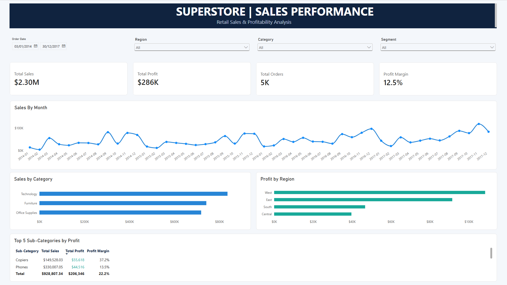

# Analyse des ventes — Superstore

Projet personnel d'analyse de données réalisé avec **Python, SQL et Power BI**. L'objectif est de suivre les ventes, les bénéfices et la rentabilité des différentes catégories de produits.

## Tableau de bord



Le rapport Power BI présente les principaux KPI, l'évolution des ventes, les résultats par catégorie et par région, ainsi que des filtres interactifs.

## Outils utilisés

- **Python (pandas, Matplotlib)** : vérification des données, conversion des dates et des types numériques, calcul des KPI et analyse mensuelle.
- **SQLite / SQL** : analyses des ventes, des bénéfices et des catégories à partir de la table `orders`.
- **Power BI** : création du tableau de bord.

## Données et préparation

J'ai utilisé le jeu de données [Sample Superstore](https://www.kaggle.com/datasets/vivek468/superstore-dataset-final), qui contient **9 994 lignes**. Les contrôles effectués dans Python n'ont détecté ni valeur manquante, ni doublon complet, ni anomalie parmi les règles vérifiées. J'ai ensuite exporté les données préparées dans `superstore_cleaned.csv`.

## Quelques résultats

| Indicateur | Résultat |
| --- | ---: |
| Ventes totales | 2 297 200,86 $ |
| Bénéfice total | 286 397,02 $ |
| Marge bénéficiaire | 12,47 % |
| Nombre de commandes | 5 009 |

**Ce que j'ai retenu :** la catégorie *Technology* génère le bénéfice le plus élevé (environ 145 455 $). *Furniture* réalise des ventes importantes, mais son bénéfice reste bien plus faible (environ 18 451 $). Cela montre l'intérêt de comparer les ventes et la rentabilité.

## Consulter le projet

- [Notebook Python](notebooks/01_sales_analysis.ipynb)
- [Requêtes SQL](sql/sales_analysis.sql)
- [Rapport Power BI](powerbi/Superstore_dashboard.pbix)

Pour reproduire l'analyse, téléchargez le CSV depuis la source indiquée, placez-le dans `data/Sample - Superstore.csv`, puis installez les dépendances avec :

```bash
python -m pip install -r requirements.txt
```

Exécutez ensuite le notebook dans l'ordre. Il génère le CSV préparé et la base SQLite utilisée pour les analyses SQL. Dans Power BI Desktop, sélectionnez `data/superstore_cleaned.csv` comme source du rapport, puis actualisez les données.

*Le fichier CSV et la base SQLite sont conservés localement et ne sont pas inclus dans le dépôt.*
